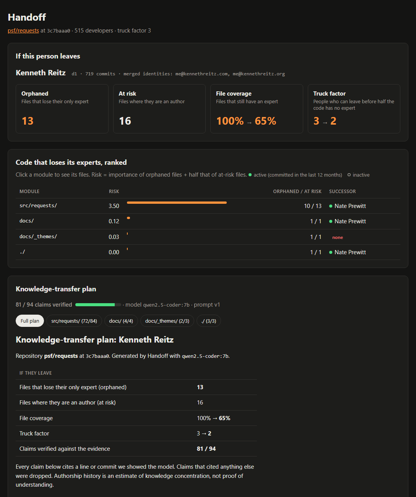

<!-- AMAN:START intro -->
# Handoff

> When a maintainer leaves, what do we lose, and what should we do before they go?

**Handoff** reads a repository's Git history, finds the code whose **last remaining expert** is a departing maintainer, ranks it by importance, and generates a **cited knowledge-transfer (KT) plan** with a local open-weight model.

Built at **DevF8rge Finals: Hacktoberfest 2026 Hack Day, Bengaluru** (30–31 Oct 2026), hosted by DevForge (Newton School of Technology) and powered by MLH.

**Theme:** AI for Open Source
<!-- AMAN:END intro -->

<!-- AVI:START demo -->
## Demo



On [psf/requests](https://github.com/psf/requests), if Kenneth Reitz leaves:

- **13 files** lose their only expert, and file coverage drops from **100% to 65%**.
- The truck factor drops from **3 to 2**.
- Almost all of the risk is in `src/requests/`, and Nate Prewitt is the suggested successor.
- The KT plan makes **94 claims, and 81 of them are verified** against the evidence. Every claim links to the exact line or commit on GitHub.

Try it without a GPU, using the saved results:

```bash
handoff serve --data-dir examples/requests     # http://127.0.0.1:8000
```

The generated plan is also in [examples/requests/KT-d1.md](examples/requests/KT-d1.md).
<!-- AVI:END demo -->

<!-- AMAN:START analysis -->
## How the analysis works

The analysis is deterministic: no LLM decides what matters.

1. **Mine history.** One `git log --no-merges -M --name-status` pass. Paths are resolved to their name at HEAD, so history survives renames. Only source files that still exist at HEAD count. Bot accounts (dependabot, renovate, …) and bulk commits (more than 100 files, e.g. reformats) are never credited, but their renames are still tracked.
2. **Merge identities.** `.mailmap` first, then the same email, the same name, or a GitHub noreply handle that matches another identity's email or name.
3. **Score authorship** with the Degree-of-Authorship model (Fritz et al.; Avelino et al.):

   ```
   DOA(d, f) = 3.293 + 1.098·FA + 0.164·DL − 0.321·ln(1 + AC)
   ```

   - FA = d created f
   - DL = d's commits to f
   - AC = everyone else's commits to f
   - d is an **author** of f when DOA ≥ 3.293 and DOA is above 75% of the file's top score.
4. **Departure impact** for one developer X:
   - **Files:** *at risk* = X is an author; *orphaned* = X is the only author.
   - **Coverage and truck factor:** compared with and without X. The truck factor is how many top authors must leave before fewer than half the files have an author.
5. **Rank** at-risk files by `0.4·LOC + 0.4·fan-in + 0.2·X's commits in the last 12 months` (each normalised).
   - **Fan-in** counts the other files that statically import the file (Python).
   - **"Last 12 months"** is measured back from the repo's latest commit, not from today.
   - **Modules** are directories, scored by the importance of their orphaned files plus half the importance of their at-risk files.
   - **The successor** is the active developer (committed in that 12-month window) with the highest summed authorship over the module.

**Example:** on [psf/requests](https://github.com/psf/requests), if Kenneth Reitz leaves, 13 files are orphaned, including `models.py`, `sessions.py` and `utils.py`. File coverage drops from 100% to 65%, and the truck factor drops from 3 to 2. See [examples/requests/analysis.json](examples/requests/analysis.json).

## Setup

```bash
python -m venv .venv
# Windows: .venv\Scripts\activate    macOS/Linux: source .venv/bin/activate
pip install -e ".[dev]"
```

## Usage

```bash
handoff analyze path/to/repo                       # analysis.json, truck factor, top authors
handoff analyze path/to/repo --who "Jane Doe"      # plus departure impact and ranked modules
handoff kt path/to/repo --who d1                   # KT-d1.md + kt.json (needs Ollama)
handoff serve                                      # web UI on http://127.0.0.1:8000
```

## Limitations

- Authorship history is an **estimate** of knowledge concentration, not a measure of understanding.
- Pair programming, code review and design discussions outside Git are invisible.
- Squash-merged PRs credit a single author; `Co-authored-by` trailers are not parsed yet.
- The DOA thresholds come from prior research and may need tuning per repo.
<!-- AMAN:END analysis -->

<!-- AVI:START generation -->
## How the KT plan is generated

The analysis decides **which** code is at risk. A local open-weight model then explains that code, and a plain-code checker removes every claim it can't back up.

1. **Evidence pack per file.** For each at-risk file in the top folders, Handoff collects, with line numbers:
   - the code outline (signatures and docstrings);
   - the departing developer's commit messages;
   - their own `TODO` / `FIXME` / `HACK` comments (from `git blame`);
   - their fix and revert commits;
   - related tests;
   - the files that import it.

   Each pack is capped at about 6k tokens.
2. **Notes per file (map).** The model returns fixed JSON:
   - purpose;
   - entry points, invariants and gotchas, **each with a citation** (`path:line` or `commit:sha`);
   - open questions for the maintainer.

   It is told to use only the evidence and to ask a question instead of guessing.
3. **Citation check.** Plain Python drops any claim whose citation was not in that file's evidence pack. An entry point must also name something that appears on the line it cites. The kept / total count is shown as "claims verified".
4. **Summary per folder (reduce).** The model writes a short summary, the most important questions and the handoff tasks from the checked notes. It can't add new cited claims at this step.
5. **Render.** Code, not the model, assembles `KT-<dev>.md` and `kt.json` from the checked claims. Each citation becomes a link to that line or commit on GitHub.
6. **Cache.** Raw model output is cached per file, keyed by (HEAD commit, developer, model, prompt version). Re-runs are instant, and the demo works offline. The checker re-runs on every load.

**Model.** `qwen2.5-coder:7b` runs through [Ollama](https://ollama.com) in JSON mode, with an 8k context and temperature 0.2, entirely on a laptop GPU (RTX 5060, 8 GB). The code never leaves the machine.

We measured both candidate models on the same evidence:

| Model | Claims verified (requests) | Time for the full plan |
|---|---|---|
| `qwen2.5-coder:7b` (default) | **86%** (81 / 94) | ~2.5 min |
| `gemma3:4b` | 63% | faster |

Gemma often cited the wrong line number, so the checker dropped more of its claims.

**What "verified" means.** A verified claim points to a line or commit the model was really shown. That stops it from inventing locations. It doesn't prove the sentence describes that line correctly, so a human should still read the plan. Every claim is one click from its source.

### Handoff Studio: run any repo from the browser

```bash
python -m handoff.studio      # http://127.0.0.1:8001 (needs Ollama)
```

In the Studio you can:

- paste a GitHub URL or a local path, and it clones and analyses the repo;
- pick who leaves from the top authors;
- generate the plan with a live progress bar;
- limit the run to the top 5 or 10 files per folder, and stop and resume it (finished files stay cached);
- delete runs.

Developers are marked active or inactive (committed in the last 12 months). Runs are kept in `~/handoff-runs/`, outside the repo. `handoff serve` stays a read-only view of saved results.
<!-- AVI:END generation -->

<!-- AMAN:START footer -->
## AI tools used

As the event rules require, we disclose every AI tool we used:

- **Claude Code (Claude Opus 5.5)**: coding assistant used for scaffolding, implementation and docs. Every team member has reviewed and can explain the code.
- TBD: open-weight models the project runs and any other assistants used.

## Credits

- Degree-of-Authorship model: Fritz et al.; truck-factor algorithm: Avelino et al.
- Demo data: Git history of [psf/requests](https://github.com/psf/requests) (Apache-2.0). Its code is not included in this repo.
- Libraries: [Typer](https://github.com/fastapi/typer), [FastAPI](https://github.com/fastapi/fastapi), [Uvicorn](https://github.com/encode/uvicorn), [ollama-python](https://github.com/ollama/ollama-python), [pytest](https://github.com/pytest-dev/pytest).

## Contributing

Contributions are welcome.

1. Fork the repo and create a branch: `git checkout -b feature/your-feature`
2. Make your changes and commit with a clear message.
3. Open a pull request that describes what changed and why.

Please open an issue first for large changes. Never commit API keys or secrets: use a local `.env` file, which git ignores.

## Team

- Aman ([@Amanrajput1206](https://github.com/Amanrajput1206))
- Avi

## License

[MIT](LICENSE)
<!-- AMAN:END footer -->
