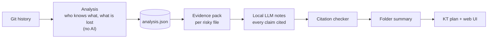
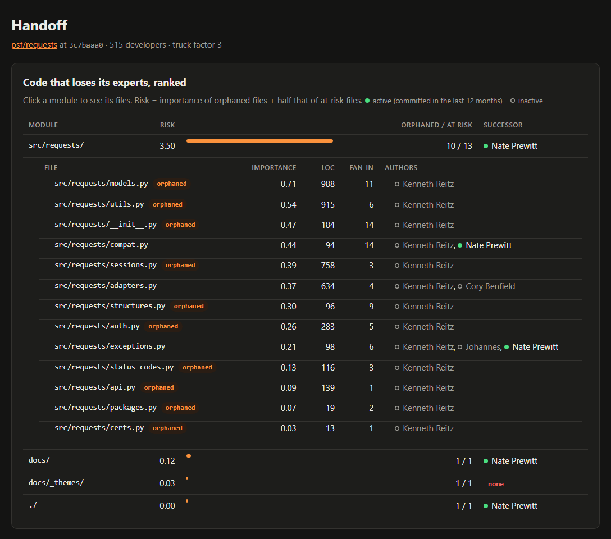
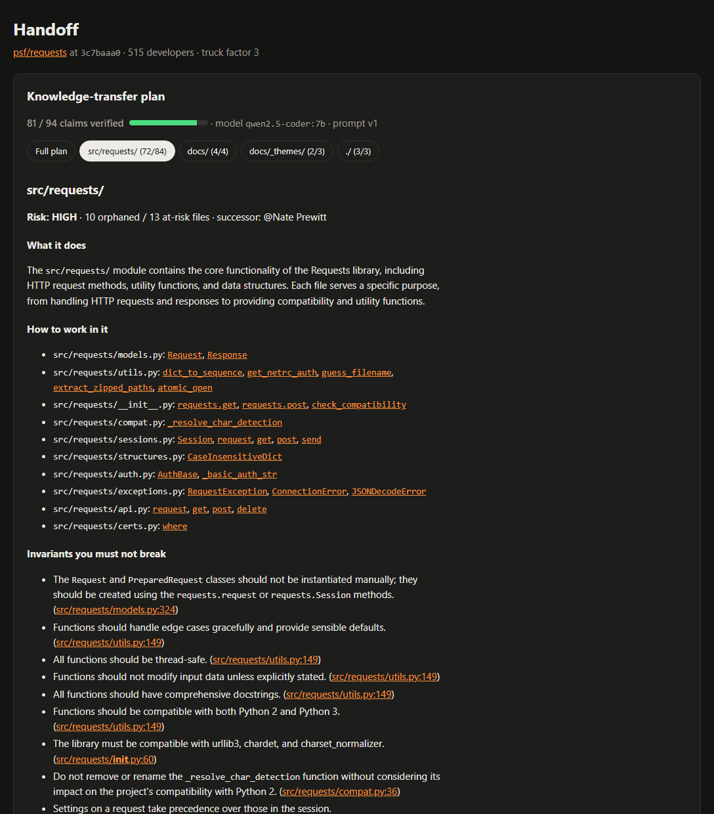
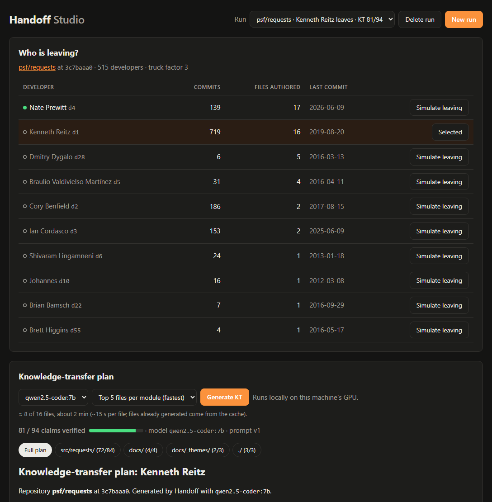

<!-- AMAN:START intro -->
# Handoff

> When a maintainer leaves, what do we lose, and what should we do before they go?

**Handoff** reads a repository's Git history and finds the code whose **last remaining expert** is a departing maintainer. It ranks that code by importance and generates a **cited knowledge-transfer (KT) plan** with a local open-weight model. The plan covers:

- what the code does;
- the rules you must not break;
- known landmines;
- who should take over;
- the questions to ask before the maintainer leaves.

Built at **DevF8rge Finals: Hacktoberfest 2026 Hack Day, Bengaluru** (30–31 Oct 2026), hosted by DevForge (Newton School of Technology) and powered by MLH.
**Theme:** AI for Open Source · **Licence:** MIT

### The idea in one line

**Math decides what matters, the AI explains it, and plain code checks every claim.**



**Contents:**

- [Demo](#demo)
- [How the analysis works](#how-the-analysis-works)
- [How the KT plan is generated](#how-the-kt-plan-is-generated)
- [Setup and usage](#setup)
- [References](#references)
<!-- AMAN:END intro -->

<!-- AVI:START demo -->
## Demo

**Live demo:** **[handoff-mu-mauve.vercel.app](https://handoff-mu-mauve.vercel.app/)**. Switch between psf/requests, pallets/click and fastapi/typer with the **Repo** picker, or open one directly with a link like [`?repo=typer`](https://handoff-mu-mauve.vercel.app/?repo=typer).


On [psf/requests](https://github.com/psf/requests) (515 developers), if **Kenneth Reitz** leaves:

| | Before | After |
|---|---|---|
| Files whose only expert leaves (**orphaned**) | | **13** |
| Files where he is an expert (**at risk**) | | 16 |
| **File coverage** (files that still have an expert) | 100% | **65%** |
| **Truck factor** | 3 | **2** |
| KT claims **verified** against the evidence | | **81 / 94** |

Almost all of the risk is in `src/requests/`, and **Nate Prewitt** is the suggested successor. Every claim in the plan links to the exact line or commit on GitHub.

The generated plan is also in [examples/requests/KT-d1.md](examples/requests/KT-d1.md).

### Three ways to run it

| | What you get | Needs |
|---|---|---|
| **1. [Hosted demo (Vercel)](https://handoff-mu-mauve.vercel.app/)** | Saved results for several sample repos, with a **Repo** picker to switch between them | A browser |
| **2. Saved results, locally** | The same page on your machine | Python |
| **3. Live generation, locally** | Analyse **any** repo and generate a new KT plan | Python + [Ollama](https://ollama.com) |

**1. Hosted.** The Vercel deployment is a **static site**: [web/index.html](web/index.html) plus the saved runs listed in [examples/index.json](examples/index.json). It serves results only and never runs a model.

**2. Saved results, locally.** Either of these works:

```bash
python -m http.server 8000      # all sample repos with the picker: http://localhost:8000/web/index.html
handoff serve --data-dir examples/requests     # one run through the API: http://127.0.0.1:8000
```

**3. Live generation, locally.**

```bash
ollama pull qwen2.5-coder:7b
python -m handoff.studio        # http://127.0.0.1:8001: paste a GitHub URL, pick who leaves, Generate KT
# or, from the terminal:
handoff analyze path/to/repo --who "Jane Doe" --out analysis.json
handoff kt path/to/repo --who d1 --analysis analysis.json --out-dir .
```

**Why generation isn't hosted:**

- Handoff runs an open-weight model **on your own GPU**, so the repository's code never leaves your machine.
- Vercel has no GPU, and its serverless functions are short-lived.

So the hosted site shows saved results, and anyone can generate their own plans locally. A plan for a mid-sized repo takes about 2–6 minutes on a laptop GPU. To add a sample repo to the hosted demo:

1. Generate it locally.
2. Copy its `analysis.json`, `kt.json` and `KT-<dev>.md` into `examples/<name>/`.
3. Add an entry to `examples/index.json`.
<!-- AVI:END demo -->

<!-- AMAN:START analysis -->
## How the analysis works

The analysis is **deterministic**: no LLM decides what matters, so every number can be reproduced and explained.

### 1. Mine the history

One `git log --no-merges -M --name-status` pass collects who changed which file, and when.

- **Renames are followed.** Paths are resolved to their name at HEAD, so a file's history survives `git mv`.
- **Only source code counts.** Files must still exist at HEAD and have a source extension. `vendor/`, `node_modules/`, `dist/`, `build/`, minified and generated files are skipped.
- **Bots are never credited:** dependabot, renovate, github-actions, pre-commit-ci and any name containing `[bot]`.
- **Bulk commits are never credited.** A commit touching more than **100 files** is usually a reformat or a licence-header change. The limit is configurable with `--bulk-limit`.

### 2. Merge identities

The same person often commits under several names and emails. Identities are merged with `.mailmap` first, then by:

- the same email;
- the same normalised name;
- a GitHub `noreply` handle that matches another identity's email or name.

### 3. Who knows a file: Degree of Authorship

For developer $d$ and file $f$, the **Degree of Authorship** model (Fritz et al. [[1]](#references), [[2]](#references)) is:

$$
\mathrm{DOA}(d, f) = 3.293 + 1.098\,\mathrm{FA} + 0.164\,\mathrm{DL} - 0.321\,\ln(1 + \mathrm{AC})
$$

| Term | Meaning | Effect |
|---|---|---|
| $\mathrm{FA}$ | 1 if $d$ created $f$, otherwise 0 | the strongest signal |
| $\mathrm{DL}$ | number of commits by $d$ to $f$ | each change adds a little |
| $\mathrm{AC}$ | number of commits to $f$ by everyone else | knowledge goes stale as others rewrite the code |

Scores are normalised per file by the best score on that file:

$$
\mathrm{DOA}_N(d, f) = \frac{\mathrm{DOA}(d, f)}{\max_{d'} \mathrm{DOA}(d', f)}
$$

If that maximum is $\le 0$, every $\mathrm{DOA}_N$ on the file is set to 0.

A developer is an **author (expert)** of a file, using the thresholds from Avelino et al. [[3]](#references), when:

$$
d \in A(f) \iff \mathrm{DOA}_N(d, f) > 0.75 \;\;\text{and}\;\; \mathrm{DOA}(d, f) \ge 3.293
$$

### 4. What is lost when $X$ leaves

Let $F$ be the source files at HEAD and $A(f)$ the authors of $f$.

$$
\mathrm{AtRisk}(X) = \lbrace f \in F : X \in A(f) \rbrace
\qquad
\mathrm{Orphaned}(X) = \lbrace f \in F : A(f) = \lbrace X \rbrace \rbrace
$$

**Coverage** is the share of files that still have at least one author once the developers in $S$ are gone:

$$
\mathrm{Cov}(S) = \frac{\left|\lbrace f \in F : A(f) \setminus S \neq \varnothing \rbrace\right|}{|F|}
$$

**Truck factor** (Avelino et al. [[3]](#references)) is how many top experts must leave before more than half of the files have no expert:

1. Rank the developers $r_1, r_2, \dots$ by the number of files they author, most first.
2. Remove them in that order until coverage drops below 50%.

$$
\mathrm{TF} = \min \lbrace k \ge 0 : \mathrm{Cov}(\lbrace r_1, \dots, r_k \rbrace) < 0.5 \rbrace
$$

The truck factor **after $X$ leaves** uses the same rule, starting with $X$ already removed and ranking only the others:

$$
\mathrm{TF}_{\text{after}} = \min \lbrace k \ge 0 : \mathrm{Cov}(\lbrace X, r_1, \dots, r_k \rbrace) < 0.5 \rbrace
$$

### 5. What matters most: importance, risk, successor

These weights are **our own documented choices**, not from research.

**Importance** of an at-risk file, from 0 to 1:

$$
I(f) = 0.4\,\widehat{\mathrm{LOC}}(f) + 0.4\,\widehat{\mathrm{FanIn}}(f) + 0.2\,\widehat{\mathrm{Recent}}_X(f)
\qquad
\widehat{v}(f) = \frac{v(f)}{\max_{g \in \mathrm{AtRisk}(X)} v(g)}
$$

| Weight | Signal | Why |
|---|---|---|
| 40% | $\mathrm{LOC}$: non-blank lines | bigger files hold more logic |
| 40% | $\mathrm{FanIn}$: other files that statically import it (Python) | central code hurts more when orphaned |
| 20% | $\mathrm{Recent}_X$: commits by $X$ to $f$ in the last 12 months | the freshest, least-documented knowledge |

"Last 12 months" is measured back from the repo's latest commit, not from today, so older repos still give meaningful results.

**Folder risk.** A module is a directory $M$:

$$
\mathrm{Risk}(M) = \sum_{f \in M \cap \mathrm{Orphaned}(X)} I(f) \;+\; 0.5 \sum_{f \in M \cap (\mathrm{AtRisk}(X) \setminus \mathrm{Orphaned}(X))} I(f)
$$

Risk is **not** bounded by 1. It grows with the amount of important code that loses its expert. The **top 5 folders** go on to KT generation.

**Successor.** Among the developers who committed in the 12 months before HEAD (the set $\mathrm{Active}$), the successor is the one with the most knowledge of the folder. If nobody qualifies, the folder shows **none**.

$$
\mathrm{Successor}(M) = \arg\max_{d \in \mathrm{Active} \setminus \lbrace X \rbrace} \; \sum_{f \in M \cap \mathrm{AtRisk}(X)} \mathrm{DOA}_N(d, f)
$$



*In the UI, a filled dot marks an active developer (committed in the last 12 months) and a hollow grey dot an inactive one.*

## Setup

```bash
python -m venv .venv
# Windows: .venv\Scripts\activate    macOS/Linux: source .venv/bin/activate
pip install -e ".[dev]"
python -m pytest -q
```

KT generation needs [Ollama](https://ollama.com) and a model: `ollama pull qwen2.5-coder:7b`.

## Usage

```bash
handoff analyze path/to/repo                       # analysis.json, truck factor, top authors
handoff analyze path/to/repo --who "Jane Doe"      # plus departure impact and ranked modules
handoff kt path/to/repo --who d1                   # KT-d1.md + kt.json (needs Ollama)
handoff serve --data-dir examples/requests         # read-only web UI on http://127.0.0.1:8000
python -m handoff.studio                           # run any repo from the browser on :8001 (needs Ollama)
```

## Limitations

- Authorship history is an **estimate** of knowledge concentration, not a measure of understanding.
- Pair programming, code review and design discussions outside Git are invisible.
- Squash-merged PRs credit a single author; `Co-authored-by` trailers are not parsed yet.
- The DOA thresholds come from prior research and may need tuning per repo.
- Fan-in is computed for Python only. Other languages still work, but rank on size and recency alone.
- Repos that are mostly documentation or lists show few developers, because only source-code files count.
<!-- AMAN:END analysis -->

<!-- AVI:START generation -->
## How the KT plan is generated

The analysis decides **which** code is at risk. A local open-weight model **explains** that code, and a plain-code **checker** removes every claim it can't back up.

### 1. Evidence pack per file

For each at-risk file in the top folders, Handoff collects the following, each with its line numbers or commit:

| Evidence | Source | Why |
|---|---|---|
| Code outline | Signatures and docstrings (Python via `ast`) | structure without blowing the budget |
| The leaver's commit messages | Git history | the *why* behind decisions |
| Their `TODO` / `FIXME` / `HACK` / `XXX` lines | `git blame` | known problems in their own words |
| Their fix / revert / workaround commits | Git history | where it broke before |
| Tests and top callers | imports | what depends on it, and what protects it |

Each pack is capped at about **6,000 tokens** (estimated as characters ÷ 4).

### 2. Notes per file (map)

The model returns fixed JSON:

- `purpose`;
- `key_entry_points`, `invariants` and `gotchas`, **each with a citation** (`path:line` or `commit:sha`);
- `open_questions` for the maintainer.

It is told to use only the evidence, and to **ask a question instead of guessing**.

### 3. Citation check

Let $E_f$ be the set of line numbers and commit SHAs shown in file $f$'s evidence pack. A claim $c$ with citations $\mathrm{cites}(c)$ is **kept** only if every citation is in the evidence:

$$
\mathrm{kept}(c) \iff \forall\, x \in \mathrm{cites}(c) : x \in E_f
$$

An entry point must also **name something that appears on the cited line** (or the 3 lines after it, to allow for decorators). All other claims are dropped. The UI shows the result as:

$$
\text{verified} = \frac{\text{claims kept}}{\text{claims kept} + \text{claims dropped}}
\qquad \text{(requests: } 81 / 94 \approx 86\%\text{)}
$$

**What "verified" means.** A verified claim points to a line or commit the model was really shown, so it can't invent locations. It doesn't prove the sentence describes that line correctly. That's why every claim is one click from its source, and a human should still read the plan.

### 4. Summary per folder (reduce)

The model writes a short summary, the most important questions and the handoff tasks from the **checked** notes. It cannot add new cited claims at this step.

### 5. Render and cache

Code, not the model, assembles `KT-<dev>.md` and `kt.json` from the checked claims. Each citation becomes a link to that line or commit on GitHub.

Raw model output is cached per file, keyed by `(HEAD commit, developer, model, prompt version)`. Re-runs are instant and the demo works offline. The checker re-runs on every load, so improving it never needs new model calls.



### Model

`qwen2.5-coder:7b` runs through [Ollama](https://ollama.com): JSON mode, an 8k context (`num_ctx: 8192`), temperature 0.2, and a 180-second timeout with one retry. Everything runs on a laptop GPU (RTX 5060, 8 GB), and **the code never leaves the machine**.

We picked the model by measuring both candidates on the same evidence:

| Model | Claims verified (requests) | Full plan |
|---|---|---|
| `qwen2.5-coder:7b` (default) | **86%** (81 / 94) | ~2.5 min |
| `gemma3:4b` | 63% | faster |

Gemma often cited the wrong line number. For example, it put `class Request` at line 289 when it is at 284, so the checker dropped more of its claims.

### Handoff Studio: run any repo from the browser

```bash
python -m handoff.studio      # http://127.0.0.1:8001 (needs Ollama)
```



In the Studio you can:

- paste a GitHub URL or a local path, and it clones and analyses the repo;
- pick who leaves from the top authors;
- generate the plan with a live progress bar;
- limit the run to the top 5 or 10 files per folder, and **Stop** and resume it (finished files stay cached);
- delete runs.

Runs are kept in `~/handoff-runs/`, outside the repo. `handoff serve` stays a read-only view of saved results.
<!-- AVI:END generation -->

<!-- AMAN:START footer -->
## References

The authorship model and the truck-factor method come from published software-engineering research. We use their formula, coefficients and thresholds unchanged.

1. T. Fritz, J. Ou, G. C. Murphy, E. Murphy-Hill. **"A degree-of-knowledge model to capture source code familiarity."** *Proceedings of the 32nd ACM/IEEE International Conference on Software Engineering (ICSE)*, 2010, pp. 385–394. [doi:10.1145/1806799.1806856](https://doi.org/10.1145/1806799.1806856)
2. T. Fritz, G. C. Murphy, E. Murphy-Hill, J. Ou, E. Hill. **"Degree-of-knowledge: Modeling a developer's knowledge of code."** *ACM Transactions on Software Engineering and Methodology (TOSEM)* 23(2), Article 14, 2014. [doi:10.1145/2512207](https://doi.org/10.1145/2512207)
3. G. Avelino, L. Passos, A. Hora, M. T. Valente. **"A novel approach for estimating truck factors."** *IEEE 24th International Conference on Program Comprehension (ICPC)*, 2016. [doi:10.1109/ICPC.2016.7503718](https://doi.org/10.1109/ICPC.2016.7503718) · [arXiv:1604.06766](https://arxiv.org/abs/1604.06766)

**Which part comes from which source:**

- The DOA formula and its coefficients come from [1, 2].
- The normalisation, the author thresholds (0.75 and 3.293, tuned against `git blame`) and the greedy truck-factor algorithm come from [3], which tested them on 133 GitHub projects.
- Our own choices: the importance weights, folder risk, successor rule, the 12-month window and the filters.

## AI tools used

As the event rules require, we disclose every AI tool we used:

- **Claude Code (Claude Opus 5.5)**: coding assistant used for scaffolding, implementation and docs. Every team member has reviewed and can explain the code.
- **`qwen2.5-coder:7b`** (default) and **`gemma3:4b`** (evaluated): open-weight models the project runs locally through Ollama to write the KT notes.

## Credits

- Demo data: Git history of [psf/requests](https://github.com/psf/requests) (Apache-2.0). Its code is not included in this repo.
- Libraries:
  - [Typer](https://github.com/fastapi/typer)
  - [FastAPI](https://github.com/fastapi/fastapi)
  - [Uvicorn](https://github.com/encode/uvicorn)
  - [ollama-python](https://github.com/ollama/ollama-python)
  - [pytest](https://github.com/pytest-dev/pytest)
  - [marked](https://github.com/markedjs/marked)
  - [DOMPurify](https://github.com/cure53/DOMPurify)

## Contributing

Contributions are welcome.

1. Fork the repo and create a branch: `git checkout -b feature/your-feature`
2. Make your changes and commit with a clear message.
3. Open a pull request that describes what changed and why.

Please open an issue first for large changes. Never commit API keys or secrets: use a local `.env` file, which git ignores.

## Team

- Aman ([@Amanrajput1206](https://github.com/Amanrajput1206)): analysis (history mining, authorship, impact, ranking, API)
- Avi ([@AvinandanPatel](https://github.com/AvinandanPatel)): generation and UI (evidence packs, LLM, citation checker, KT plan, web UI, Studio)

## License

[MIT](LICENSE)
<!-- AMAN:END footer -->
